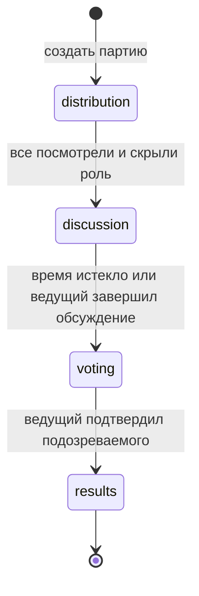

# Правила первого среза: «Шпион»

Рабочая механика для проверки, не обещание точного воспроизведения чужого издания.
Контент в репозитории написан для проекта. Первые настройки: 4–12 игроков, один
шпион, 3–15 минут, по умолчанию 5 минут. Имена после trim непустые; ID уникальны.
Одинаковые имена допустимы: идентичность задаёт ID.

## Фазы

В `distribution` каждый видит закрытую карточку с собственным именем, нажимает
«Показать», читает и нажимает «Скрыть и передать». Все обычные игроки знают одну
локацию; шпион видит только свою роль. Локация выбирается случайно из пакета;
шпион — случайно из состава. Приложение не отправляет роли в логи и аналитику.

Ядро отвечает за выдачу, порядок подтверждений и переходы. Скрытие карточки и
защита от фона — состояние UI-контроллера: inactive/paused/hidden закрывают роль,
возврат оставляет её закрытой. Подтверждение передачи проверяет ID текущего
игрока и открытое состояние карточки; повторное нажатие не пропускает участника.

Обсуждение происходит вслух. Таймер стартует после последней передачи телефона.
По окончании времени начинается выбор подозреваемого; ведущий также может закончить
обсуждение раньше. В первой локальной версии компания голосует вслух, ведущий
вводит коллективный выбор. Это не тайное индивидуальное голосование.

Подтверждение подозреваемого раскрывает роль: выбран шпион → победили остальные,
выбран другой игрок → победил шпион. Ничья решается повторным устным голосованием
до ввода результата. Угадывание локации шпионом, несколько шпионов и очки серии
партий пока не реализуются. Повторный раунд создаёт новую сессию с теми же именами.

## Инварианты и тесты

- Ровно один шпион; у него нет локации в личном представлении.
- Все остальные получают одну локацию.
- Публичная проекция до results не содержит роли, локацию и ID шпиона.
- Показ чужой роли UI не предлагает; ядро требует существующий player ID.
- Подтверждать выдачу может только текущий игрок и только один раз.
- Нельзя перейти к голосованию до discussion и раскрыть результат до voting.
- Неизвестный подозреваемый и повторное завершение отклоняются.
- Время и случайность внедряются, тесты воспроизводимы.

## После первой игры

### Темы и повторные раунды PB-025

Три встроенные темы по 24 локации: «Знакомые места», «Вокруг света»,
«За гранью обычного». Последняя содержит вымышленные места; перед началом
договоритесь об их представлении. Выбор темы доступен до раздачи, в сети — ведущему.
Выбранные локация и версия набора не меняются в активном раунде.
Набор проходится без повторов; первый выбор нового прохода отличается от последнего
предыдущего. Локальная история сохраняется до выхода из игрового экрана, сетевая —
до истечения комнаты, включая отмену и рестарт. Темы имеют независимые истории.
На телефоне после перезапуска восстанавливается только подготовка, включая тему.
Кнопка «О чём спросить?» во время обсуждения показывает нейтральные вопросы,
одинаковые для всех тем и ролей, без подсказки выбранного места.

«Под прикрытием», «Крокодил», «Кто из нас?» и игра на ассоциации остаются кандидатами.
Для каждой сначала отдельная короткая спецификация: состав, шаги, победа, контент,
время, режим одного телефона и сетевые ограничения. Число игр релиза пока открыто.

## Сетевой срез PB-040

Правила победы и настройки те же. В сети каждый читает только свою карточку
и подтверждает её независимо от порядка; обсуждение начинается после всех
подтверждений. Сервер собирает readyIds, а общие правила упорядоченной раздачи
применяет к уже подтверждённым участникам. Устное голосование остаётся общим;
действия начала партии, окончания обсуждения, выбора и отмены доступны ведущему.
Список участников фиксируется на раунд. Вход во время раздачи/обсуждения/голосования
закрыт. Явный выход отменяет активный раунд и возвращает комнату в лобби;
disconnect сохраняет роль и участие. Ведущий может отменить раунд, если кто-то
не возвращается. Это рабочие допущения первой сетевой версии, [ADR 0005](adr/0005-network-spy.md).

Серверная реализация: apps/backend/src/games/spy.ts. Совместимые векторы:
packages/game-contracts/vectors/spy-v1.json, выполняются в Node и Dart. Правила
не читают часы и не выбирают случайность сами; эти значения задаёт сервер/адаптер.
