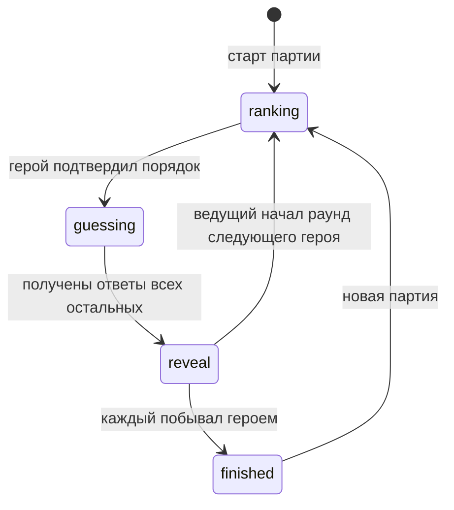

# Правила игр

## Сетевой «Шпион» — личное голосование PB-052

В новых партиях rooms-v5 каждый участник выбирает подозреваемого на своём
телефоне. Голос закрытый, один на тур, включая ведущего и шпиона; выбор себя
допустим. До последнего голоса виден только прогресс. Побеждает уникальный
лидер по числу голосов; при ничьей все голосуют заново среди лидеров.
Роли до завершения не раскрываются. Обрыв связи сохраняет место и голос;
явный выход отменяет раунд. Ведущий может отменить раунд, но не решить за всех.
Это допущения [PB-052](plans/PB-052-personal-voting-and-build.md).
Устное голосование ниже относится к одному телефону и старым сетевым партиям.

## «Шкала терпения» — PB-031

Источник — [план будущих игр](../Partybox-igry.md). В этой реализации у каждого
участника свой телефон; требуется комната и 4–12 участников. Дальнейшие детали —
рабочие допущения первого среза, [ADR 0007](adr/0007-tolerance-and-protocol-v3.md).

Партия — полный круг: каждый становится героем один раз по порядку входа. Сервер
выбирает четыре разные карточки мелких неприятностей и одну целевую из них.
Герой тайно составляет полный порядок от «переживу» до «вечер испорчен» и
подтверждает его один раз. До подтверждения его порядок никому не виден.

После подтверждения компания видит три карточки в порядке героя и отдельно
целевую. Остальные обсуждают и каждый тайно выбирает одно из четырёх мест:
перед первой, между первой и второй, между второй и третьей, после третьей.
Места в протоколе нумеруются от 0 до 3. Герой не голосует. Ответ после отправки
не меняется. Другие видят только факт ответа, без выбранного места.

После последнего ответа сервер раскрывает полный порядок и догадки, начисляет
по одному очку за точное место. Герой в своём раунде очков не получает.
Ведущий начинает следующий раунд; после последнего раскрытия открывает итог.
Побеждают все участники с максимальным счётом, включая ничью. Можно сыграть снова
или выбрать «Шпиона» в той же комнате.

Встроенный русский набор содержит 220 ситуаций для компании взрослых, без
эксплицитных тем: повседневные неудобства, работа, свидания, общие деньги,
вечеринки и привычки партнёров. На партию выбираются 16–48 разных карточек
(по четыре на каждого из 4–12 участников), внутри партии повторов нет.
Между отдельными партиями повторы возможны. Набор не задаёт возрастной рейтинг
приложения в магазинах.

Таймер не ограничивает обсуждение. Отменить партию может ведущий, например,
если участник не возвращается. Явный выход любого участника отменяет партию;
обрыв связи сохраняет участие. Сервер сохраняет игру при рестарте.
Повтор принятой команды не меняет результат и не начисляет очки второй раз.

Закрытые порядок и догадки на телефоне живут только в памяти. Фон и потеря
связи закрывают личный экран; восстановление получает только собственные данные.
Правила, проверка игрока, фаз, перестановки и начисление очков находятся на сервере.

## «Шпион»

Рабочая механика для проверки, не обещание точного воспроизведения чужого издания.
Контент в репозитории написан для проекта. Первые настройки: 4–12 игроков, один
шпион, 3–15 минут, по умолчанию 5 минут. Имена после trim непустые; ID уникальны.
Одинаковые имена допустимы: идентичность задаёт ID.

## Фазы

```mermaid
stateDiagram-v2
  [*] --> distribution: создать партию
  distribution --> discussion: все посмотрели и скрыли роль
  discussion --> voting: время истекло или ведущий завершил обсуждение
  voting --> results: локально ведущий подтвердил выбор; в сети v5 проголосовали все и есть лидер
  results --> [*]
```

В `distribution` каждый видит закрытую карточку с собственным именем, нажимает
«Показать мою роль» или тянет обложку вверх и удерживает. Отпускание скрывает роль;
передача — отдельное нажатие «Передать телефон» (или «Скрыть и передать» при
открытии кнопкой). Все обычные игроки знают одну
локацию; шпион видит только свою роль. Локация выбирается случайно из пакета;
шпион — случайно из состава. Приложение не отправляет роли в логи и аналитику.

Ядро отвечает за выдачу, порядок подтверждений и переходы. Скрытие карточки и
защита от фона — состояние UI-контроллера: inactive/paused/hidden закрывают роль,
возврат оставляет её закрытой. Подтверждение передачи проверяет ID текущего
игрока, факт просмотра его роли и передний план; повторное нажатие не пропускает
участника. Отпускание жеста само по себе не подтверждает просмотр.

Обсуждение происходит вслух. Таймер стартует после последней передачи телефона.
По окончании времени начинается выбор подозреваемого; ведущий также может закончить
обсуждение раньше. В первой локальной версии компания голосует вслух, ведущий
вводит коллективный выбор. Это не тайное индивидуальное голосование.

Подтверждение подозреваемого раскрывает роль: выбран шпион → победили остальные,
выбран другой игрок → победил шпион. Ничья решается повторным устным голосованием
до ввода результата. Угадывание локации шпионом, несколько шпионов и очки серии
партий пока не реализуются. Повторный раунд создаёт новую сессию с теми же именами.

## Инварианты и тесты

- Ровно один шпион; у него нет локации в личном представлении.
- Все остальные получают одну локацию.
- Публичная проекция до results не содержит роли, локацию и ID шпиона.
- Показ чужой роли UI не предлагает; ядро требует существующий player ID.
- Подтверждать выдачу может только текущий игрок и только один раз.
- Нельзя перейти к голосованию до discussion и раскрыть результат до voting.
- Неизвестный подозреваемый и повторное завершение отклоняются.
- Время и случайность внедряются, тесты воспроизводимы.

## После первой игры

### Темы и повторные раунды PB-025

Три встроенные темы по 60 локаций (180 всего): «Знакомые места», «Вокруг света»,
«За гранью обычного». Последняя содержит вымышленные места; перед началом
договоритесь об их представлении. Выбор темы доступен до раздачи, в сети — ведущему.
Выбранные локация и версия набора не меняются в активном раунде.
Набор проходится без повторов; первый выбор нового прохода отличается от последнего
предыдущего. Локальная история сохраняется до выхода из игрового экрана, сетевая —
до истечения комнаты, включая отмену и рестарт. Темы имеют независимые истории.
На телефоне после перезапуска восстанавливается только подготовка, включая тему.
Кнопка «О чём спросить?» во время обсуждения показывает нейтральные вопросы,
одинаковые для всех тем и ролей, без подсказки выбранного места.

«Под прикрытием», «Крокодил», «Кто из нас?» и игра на ассоциации остаются кандидатами.
Для каждой сначала отдельная короткая спецификация: состав, шаги, победа, контент,
время, режим одного телефона и сетевые ограничения. Число игр релиза пока открыто.

## Сетевой срез PB-040

Правила победы и настройки те же. В сети каждый читает только свою карточку
и подтверждает её независимо от порядка; обсуждение начинается после всех
подтверждений. Сервер собирает readyIds, а общие правила упорядоченной раздачи
применяет к уже подтверждённым участникам. Устное голосование остаётся общим;
действия начала партии, окончания обсуждения, выбора и отмены доступны ведущему.
Список участников фиксируется на раунд. Вход во время раздачи/обсуждения/голосования
закрыт. Явный выход отменяет активный раунд и возвращает комнату в лобби;
disconnect сохраняет роль и участие. Ведущий может отменить раунд, если кто-то
не возвращается. Это рабочие допущения первой сетевой версии, [ADR 0005](adr/0005-network-spy.md).

Серверная реализация: apps/backend/src/games/spy.ts. Совместимые векторы:
packages/game-contracts/vectors/spy-v1.json, выполняются в Node и Dart. Правила
не читают часы и не выбирают случайность сами; эти значения задаёт сервер/адаптер.

## «Что объединяет?» — PB-048

Один игрок или компания из1–12 участников. Партия — пять разных заданий из
авторского набора60. У каждого задания четыре подсказки от общей к конкретной.
Верный ответ приносит4/3/2/1 очко в зависимости от открытой подсказки; максимум20.
Угаданный ответ зафиксирован. После ошибки новую попытку можно сделать только
после следующей подсказки. Опечатки автоматически не исправляются; ё/е, регистр,
лишние пробелы и знаки нормализуются. Допустимые синонимы заданы в контенте.

Одному подсказки открывает сам игрок; последняя неверная попытка раскрывает ответ.
Можно завершить задание без ответа. В комнате подсказки общие, их открывает
ведущий. Все верные ответы завершают задание; на последней подсказке достаточно
ответов всех. Ведущий может явно открыть результат последней подсказки, чтобы
не ждать отошедшего игрока. На результате видны ответы и очки, затем ведущий
переводит к следующему заданию. После пятого объявляются все участники с лучшим счётом.

Письменные ответы других участников и будущие подсказки скрыты до результата.
Повтор команды не даёт дополнительных очков. Выход участника отменяет текущую
партию и возвращает оставшихся в лобби. Новое прохождение solo использует
ротацию без повторов до исчерпания набора; сервер гарантирует отсутствие повторов
внутри одной партии. Между сетевыми партиями повторения возможны.

## «Не может быть!» — PB-055

Играют 2–12 человек. Перед стартом можно выбрать одну тему, несколько или
«Всё вперемешку». В партии десять разных утверждений. Сначала каждый тайно
выбирает «Правда» или «Выдумка». После обсуждения все ещё раз отвечают тайно
и ставят 1–3 очка. Второй ответ может отличаться от первого.

После последней ставки игра показывает вердикт, объяснение, источники,
оба выбора каждого игрока и счёт. За верный финальный ответ ставка
прибавляется, за неверный вычитается. Счёт может быть отрицательным.
Побеждают все участники с максимальным итоговым счётом. Таймера и выбывания нет.

На общем телефоне экран передачи отделяет решения игроков. На отдельных
телефонах обсуждение проходит голосом, а ведущий переключает этапы.
Обрыв связи сохраняет место. Явный выход отменяет партию.

## «Мутные сделки» — PB-057

На отдельных телефонах играют от двух до шести человек. Каждый получает 40
монет, по товару стоимостью 2, 5 и 8 и выбирает одну из двух тайных целей.
Цель требует как минимум одну покупку у другого участника. В дуэли один вариант
цели связан с продажей товара любой категории. Задания на покупку двух товаров
конкретной пары категорий стоимостью 2 и 8 выпадают при трёх и более участниках.
Если цель требует два товара, повторный выкуп той же карточки считается за один.
Игра длится пять раундов. Во втором и четвёртом каждый получает новый товар, а на рынке
открывается событие.

В раунде у игрока один закрытый лот и одна покупка. Можно блефовать о
категории и стоимости, предлагать встречную цену или покупать по
заявленной. Продавец может принять любое актуальное предложение на свой лот.
После покупки содержимое видит покупатель. Платная проверка одного лота
и разовая страховка позволяют управлять риском. Обсуждение идёт голосом.

Если все пропустили продажу, сразу открывается рынок. Если есть чемоданы, торги
завершаются через три минуты или после готовности всех. Каждый без
покупки может выбрать открытый лот рынка или пропустить покупку. При заявках
на один лот побеждает первый по циклическому приоритету. Приоритет сдвигается
в начале следующего раунда. Итог — монеты, стоимость оставшихся товаров и
бонус тайной цели. Ничья сохраняется.

[Правила бумажного прототипа](playtests/PB-057-deals.md) ·
[Сетевой протокол](PROTOCOL.md#pb-057--мутные-сделки-rooms-v7)
