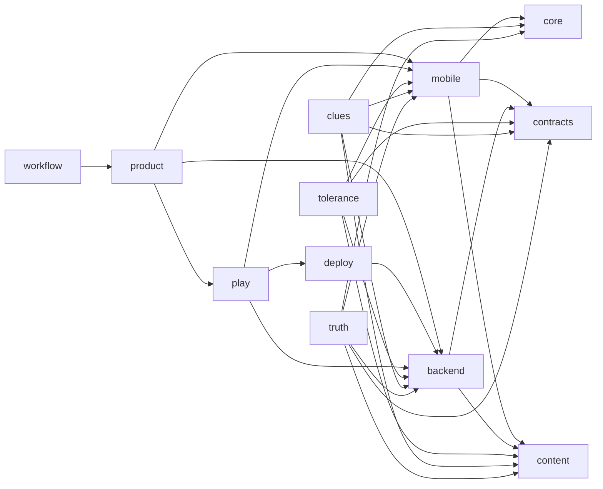

# Карта связей проекта

Это проверяемый индекс исходников и решений, а не копия кода. Источник текущих
возможностей — [STATUS](STATUS.md), требований — [PRODUCT](PRODUCT.md).
Обновлять при изменении границ модулей. Команды ниже запускаются из корня.
`node scripts/project-context.mjs <модуль>` выводит только пути и проверки;
`node scripts/project-context.mjs --check` проверяет существование путей и узлов.

Стрелка означает зависимость или необходимость согласования. Таблица — источник
данных для CLI; имена модулей и относительные пути должны оставаться точными.

| Модуль    | Читать по необходимости                                                                                                                                                                                                                                                                                | Проверки                                                                                                           |
| --------- | ------------------------------------------------------------------------------------------------------------------------------------------------------------------------------------------------------------------------------------------------------------------------------------------------------ | ------------------------------------------------------------------------------------------------------------------ |
| product   | `docs/PRODUCT.md`, `docs/BACKLOG.md`, `docs/GAME_RULES.md`, `Partybox-igry.md`, `docs/plans`                                                                                                                                                                                                           | `git diff --check`                                                                                                 |
| mobile    | `apps/mobile/lib/src`, `apps/mobile/test`, `docs/DESIGN_SYSTEM.md`, `docs/DESIGN_TOOLING.md`, `scripts/build-android-release.sh`, `docs/release/PB-047-readiness.md`                                                                                                                                   | `make check-mobile`                                                                                                |
| core      | `packages/game_core/lib`, `packages/game_core/test`, `docs/GAME_RULES.md`                                                                                                                                                                                                                              | `make check-mobile`                                                                                                |
| backend   | `apps/backend/src`, `apps/backend/test`, `docs/ARCHITECTURE.md`, `docs/PROTOCOL.md`                                                                                                                                                                                                                    | `npm run check`                                                                                                    |
| contracts | `packages/game-contracts/schemas`, `packages/game-contracts/examples`, `packages/game-contracts/tool`, `packages/game-contracts/test`, `docs/PROTOCOL.md`                                                                                                                                              | `npm run generate --workspace @partybox/game-contracts`, `npm run check`                                           |
| content   | `packages/game-content`, `packages/game-contracts/schemas`, `packages/game-contracts/test/content-schema.test.mjs`                                                                                                                                                                                     | `npm run check`, `make check-mobile`                                                                               |
| deploy    | `deploy`, `.github/workflows/ci.yml`, `.github/workflows/deploy-backend.yml`, `docs/deploy/VPS.md`, `docs/deploy/PRODUCTION.md`, `docs/adr/0010-standalone-caddy-and-manual-cd.md`                                                                                                                     | `node deploy/smoke.mjs`, `node --test deploy/production/test-release.mjs`, `node deploy/production/test-smoke.mjs` |
| workflow  | `AGENTS.md`, `docs/WORKFLOW.md`, `docs/PROJECT_GRAPH.md`, `skills/partybox-delivery/SKILL.md`, `docs/AI_DEVELOPMENT.md`, `docs/PERFORMANCE.md`, `.serena/project.yml`, `.serena/memories`, `scripts`                                                                                                   | `node scripts/doctor.mjs`, `node scripts/project-context.mjs --check`                                              |
| tolerance | `docs/plans/PB-031-tolerance.md`, `docs/adr/0007-tolerance-and-protocol-v3.md`, `apps/backend/src/games/tolerance.ts`, `apps/mobile/lib/src/rooms/tolerance_panel.dart`, `packages/game-contracts/schemas/rooms-v3.schema.json`                                                                        | `npm run check`, `make check-mobile`                                                                               |
| play      | `docs/PLAY_WITH_FRIENDS.md`, `docs/plans/PB-041-spy-play.md`, `docs/adr/0008-browser-play.md`, `scripts/play.mjs`, `scripts/play-server.mjs`, `scripts/test`                                                                                                                                           | `npm run test:tools`, `make check-mobile`                                                                          |
| clues     | `docs/plans/PB-048-clues-and-web.md`, `docs/adr/0012-clues-and-shared-web.md`, `packages/game_core/lib/src/clues_session.dart`, `apps/backend/src/games/clues.ts`, `apps/mobile/lib/src/clues`, `apps/mobile/lib/src/rooms/clues_panel.dart`, `packages/game-contracts/schemas/rooms-v4.schema.json`   | `npm run check`, `make check-mobile`, `node deploy/smoke.mjs`                                                      |
| truth     | `docs/plans/PB-055-truth-or-trick.md`, `docs/adr/0014-truth-and-protocol-v6.md`, `packages/game_core/lib/src/truth_session.dart`, `apps/backend/src/games/truth.ts`, `apps/mobile/lib/src/truth`, `apps/mobile/lib/src/rooms/truth_panel.dart`, `packages/game-contracts/schemas/rooms-v6.schema.json` | `npm run check`, `make check-mobile`                                                                               |

Для изменения формата: схема → совместимые примеры → генератор → сервер и клиент.
Для новой сетевой игры: правила → контент → контракт → серверные проекции → UI →
полный цикл с несколькими клиентами → независимое ревью. Контент/роли/токены
пользовательских сессий в карту, планы и отчёты не добавлять.
